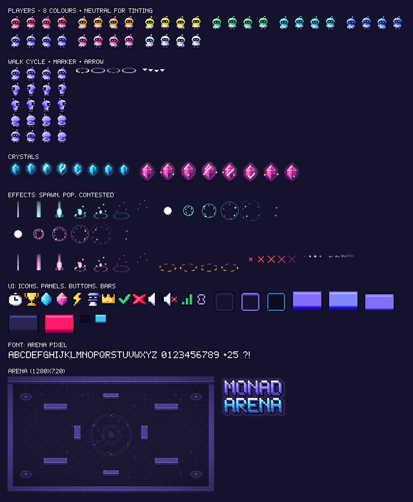

# Monad Arena — Asset Pack

An original pixel-art pack made for this game: 9 player skins, 2 crystal types, 10 effects, a 1280×720 arena with collision data, a UI kit, a bitmap font, 11 sound effects and a music loop. Everything lives in `apps/web/public/assets/` and is described in `apps/web/public/assets/manifest.json`.



All art is drawn at native resolution and exported at **2×**, so the Phaser game must use `pixelArt: true` (no smoothing). Every asset is generated by `tools/asset-gen/` and can be rebuilt with one command (see the end).

## What's in the pack

| Folder | Files | Notes |
| --- | --- | --- |
| `sprites/players/` | `player-{red,orange,yellow,green,cyan,blue,purple,pink}.png`, `player-neutral.png` | 48×48 frames, 4 cols × 5 rows. `neutral` is light grey, so tint it for players 9–16 |
| `sprites/players/` | `player-marker.png` (48×20 ×4), `player-arrow.png` (18×20 ×4) | White; tint with the local player's colour |
| `sprites/crystals/` | `crystal-standard.png` (48×48 ×8), `crystal-rare.png` (64×64 ×8) | 10 points and 25 points |
| `sprites/fx/` | `fx-spawn`, `fx-spawn-rare`, `fx-pop`, `fx-pop-rare` (64×64 ×7) | Crystal appears / crystal claimed |
| `sprites/fx/` | `fx-contested` (64×64 ×4), `fx-beaten` (32×32 ×5), `fx-sparkle` (16×16 ×4), `fx-dust` (20×16 ×4) | Ticket out / lost race / twinkle / footsteps |
| `maps/` | `arena-bg.png` (1280×720), `arena.json`, `tileset.png` (32px tiles) | Background, walls, spawn points |
| `ui/` | `icons.png` + `icons.json` (atlas, 24×24 icons) | timer, trophy, crystal, crystal-rare, bolt, player, crown, check, cross, sound-on, sound-off, signal, link |
| `ui/` | `panel`, `panel-accent`, `input`, `button-{primary,secondary,danger}[-hover,-pressed]`, `bar-bg`, `bar-fill` | 9-slice textures; use 8 px slices |
| `ui/` | `logo.png`, `favicon-32.png`, `favicon-64.png`, `apple-touch-icon.png`, `og-image.png` | Branding and web meta |
| `fonts/` | `arena-font.png/.xml`, `arena-font-outline.png/.xml` | BMFont XML. Use the outline font over gameplay |
| `audio/sfx/` | `pickup`, `pickup-rare`, `beaten`, `spawn`, `countdown-tick`, `countdown-go`, `match-end`, `ui-click`, `ui-hover`, `tx-confirm`, `join` | `.ogg` + `.mp3` |
| `audio/music/` | `arena-loop` | 15 s seamless loop at 128 BPM, `.ogg` + `.mp3` |

### Player sheet layout

| Row | Frames | Animation |
| --- | --- | --- |
| 0 | 0–3 | walk down |
| 1 | 4–7 | walk left |
| 2 | 8–11 | walk right |
| 3 | 12–15 | walk up |
| 4 | 16–17 / 18–19 | idle down / idle up |

Idle left and right use frames 5 and 9. Set sprite origin to `(0.5, 0.86)` so the position is the character's feet.

### Arena data (`maps/arena.json`)

- `walls`: 12 rectangles in world pixels. Create one static Arcade body per rectangle; the art matches them exactly.
- `spawns`: 16 start points on the four corner pads, in join order.
- `crystalMargin`: 48. Spawn crystals at least this far from any wall.

### Colour order

Assign colours in this order as players join: red, cyan, yellow, purple, green, orange, blue, pink. After 8 players, use `player-neutral` with a tint.

## Using it in Phaser

```ts
// main.ts
new Phaser.Game({
  type: Phaser.AUTO,
  width: 1280,
  height: 720,
  pixelArt: true,
  scale: { mode: Phaser.Scale.FIT, autoCenter: Phaser.Scale.CENTER_BOTH },
  physics: { default: 'arcade' },
  scene: [BootScene, ArenaScene],
});
```

```ts
// BootScene.ts: load everything from the manifest, then build animations
import manifest from '../../public/assets/manifest.json';

export class BootScene extends Phaser.Scene {
  constructor() { super('boot'); }

  preload() {
    this.load.setPath('/');
    for (const s of [...manifest.players, ...manifest.sprites]) {
      this.load.spritesheet(s.key, s.url, { frameWidth: s.frameWidth, frameHeight: s.frameHeight });
    }
    for (const i of manifest.images) this.load.image(i.key, i.url);
    for (const n of manifest.nineSlice.items) this.load.image(n.key, n.url);
    for (const a of manifest.atlases) this.load.atlas(a.key, a.textureURL, a.atlasURL);
    for (const f of manifest.bitmapFonts) this.load.bitmapFont(f.key, f.textureURL, f.fontDataURL);
    for (const a of [...manifest.audio.sfx, ...manifest.audio.music]) this.load.audio(a.key, a.urls);
    for (const d of manifest.data) this.load.json(d.key, d.url);
  }

  create() {
    for (const s of [...manifest.players, ...manifest.sprites]) {
      for (const a of s.anims) {
        this.anims.create({
          key: a.key,
          frames: this.anims.generateFrameNumbers(s.key, { frames: a.frames }),
          frameRate: a.frameRate,
          repeat: a.repeat,
        });
      }
    }
    this.scene.start('arena');
  }
}
```

```ts
// ArenaScene.ts: background, walls, a player, a crystal, text, a panel, sound
const map = this.cache.json.get('arena-map');
this.add.image(0, 0, 'arena-bg').setOrigin(0);

const walls = this.physics.add.staticGroup();
for (const w of map.walls) {
  const r = this.add.rectangle(w.x + w.w / 2, w.y + w.h / 2, w.w, w.h).setVisible(false);
  walls.add(r);
}

const me = this.physics.add.sprite(map.spawns[0].x, map.spawns[0].y, 'player-red')
  .setOrigin(0.5, 0.86)
  .play('player-red-idle-down');
me.body.setSize(20, 12).setOffset(14, 30);           // feet-sized hitbox
this.physics.add.collider(me, walls);

const ring = this.add.sprite(me.x, me.y, 'player-marker').play('player-marker').setTint(0xff4d6d);

const crystal = this.add.sprite(640, 360, 'crystal-standard').setOrigin(0.5, 0.78).play('crystal-standard');

// on chain:claimed
this.add.sprite(crystal.x, crystal.y - 10, 'fx-pop').play('fx-pop').once('animationcomplete', (_: unknown, s: Phaser.GameObjects.Sprite) => s.destroy());
this.sound.play('sfx-pickup');
this.add.bitmapText(crystal.x, crystal.y - 40, 'arena-font-outline', '+10', 14).setOrigin(0.5).setTint(0x7df3ff);

// HUD panel and icon
this.add.nineslice(16, 16, 'panel', undefined, 220, 64, 8, 8, 8, 8).setOrigin(0);
this.add.image(36, 48, 'icons', 'timer');

// music
this.sound.play('music-arena-loop', { loop: true, volume: 0.35 });
```

For React screens (home, lobby, results), use `logo.png`, the 9-slice PNGs as CSS `border-image` with `image-rendering: pixelated`, and the favicons and `og-image.png` in `index.html`.

### Suggested effect timing

| Event | Visual | Sound |
| --- | --- | --- |
| Crystal spawns | `fx-spawn` / `fx-spawn-rare`, then start the crystal animation | `sfx-spawn` |
| Ticket issued (`contested`) | `fx-contested` under the crystal | none |
| You won the claim | `fx-pop` / `fx-pop-rare`, "+10" / "+25" bitmap text | `sfx-pickup` / `sfx-pickup-rare` |
| Someone else won | `fx-pop` for everyone; `fx-beaten` over your player if you held a ticket | `sfx-beaten` (only for you) |
| Tx counter ticks | small scale bump on the counter | `sfx-tx-confirm` at low volume |
| Countdown 3-2-1-GO | big bitmap text | `sfx-countdown-tick` ×3, `sfx-countdown-go` |
| Match ends | results panel | `sfx-match-end` |

The `.mp3` music adds a tiny gap at the loop point because of encoder padding; browsers that support `.ogg` (Chrome, Firefox, Android, recent Safari) loop it seamlessly.

## Rebuilding or changing assets

```bash
pip install pillow numpy        # ffmpeg must be installed for audio
python3 tools/asset-gen/build.py
```

The palette lives in `tools/asset-gen/common.py`, player colours in `PLAYER_COLORS`, and wall rectangles in `WALLS` inside `tools/asset-gen/arena.py`. Rebuilding rewrites the whole `assets/` folder, `manifest.json` and `docs/assets-preview.png`.

## License

Original work created for Monad Arena, released under the repository's MIT license. No third-party art, fonts or samples are included.
