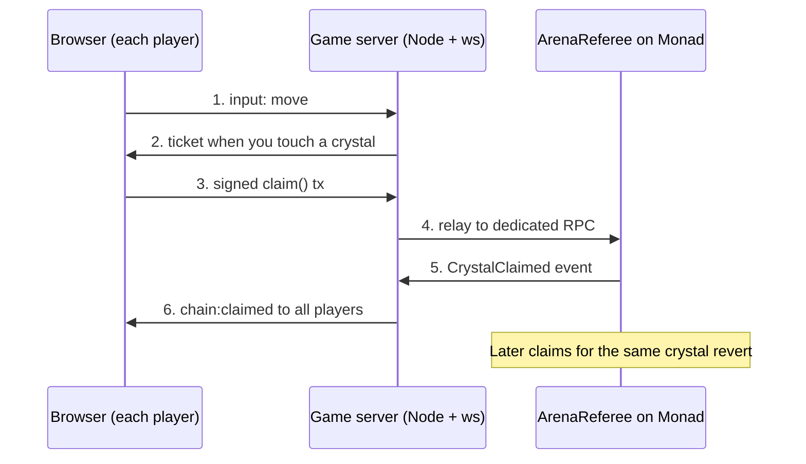

# Monad Arena — AI Build Spec

Oct 27, 2026 · Arpan Roy

## How to use this doc with an AI coding assistant

This is the single source of truth for building Monad Arena. Give it to the AI first, then build one phase at a time.

1. Save this doc as `SPEC.md` in the repo root. If you use Claude Code, also copy it into `CLAUDE.md` so every session loads it.
2. Also give the AI Monad's own AI-friendly docs index: `https://docs.monad.xyz/llms.txt`. Tell it to trust that over its memory for network details.
3. Build in the order of the Build phases section. Paste one phase prompt at a time. Never ask for the whole app in one prompt.
4. After each phase, run its "Done when" check yourself, then commit. If it fails, paste the error back to the AI instead of moving on.
5. When the AI wants to change a rule in this doc (message names, contract interface, env vars), update the doc first so the next session stays consistent.

Hackathon rule check: Monad Blitz events usually require project code to be written during the event. Use this doc as the plan, practise the patterns beforehand on a throwaway repo, and start the real repo when building opens. Confirm the exact rules for your event.

## Product summary: the blockchain is the referee

Monad Arena is a top-down multiplayer browser game where every crystal pickup is a real Monad transaction, and the chain decides who got it first.

**One-line pitch:** "Every crystal you grabbed was a transaction. When two players touched it at once, Monad picked the winner."

**How a pickup works**

1. The game server watches player positions. When a player touches an unclaimed crystal, the server sends that player a signed **touch ticket**.
2. The player's browser instantly signs a `claim()` transaction with its **burner wallet** and sends it.
3. The `ArenaReferee` contract checks the ticket and accepts only the **first** valid claim for that crystal. Later claims revert.
4. The contract emits `CrystalClaimed`. The server sees the event and tells every player who won the crystal.
5. Scores live only in the contract. The leaderboard is read from the chain.

**Why this wins "why Monad?"**

- Pickups must settle in under a second to feel playable. Monad's ~400 ms blocks make that possible.
- Races between players are decided on-chain, not by the server, so the judge can verify every point on the explorer.
- The demo shows a burst of real transactions during a 90-second match.

**Trust model, stated honestly:** the server signs tickets, so it decides who *touched* a crystal. The chain decides who *claimed it first* and keeps the score. The server cannot add points or pick a race winner.

## Game rules and scope

One map, one mode, one room at a time: short matches that anyone can join from a phone by scanning a QR code.

| Rule | Setting | Notes |
| --- | --- | --- |
| Players per room | 2–16 | Higher than a normal game so the demo audience can join |
| Match length | 90 seconds | Short enough to run twice during judging |
| Map | One 1280 × 720 top-down arena | Ready-made in `apps/web/public/assets/maps/` (see `ASSETS.md`) |
| Standard crystal | 10 points | Spawns every 2 s, max 12 on map |
| Rare crystal | 25 points | One every 15 s, glows; causes the best races |
| Controls (desktop) | WASD / arrow keys | |
| Controls (phone) | Tap or drag to move | Simpler than a joystick, works for QR joiners |
| Wallet | Auto-created burner wallet | No MetaMask, no popups |
| Winner | Highest on-chain score when timer ends | Ties: earliest last claim wins |

**In scope (must ship)**

- [ ] Lobby with nickname, room code and QR join
- [ ] Movement and live positions for all players
- [ ] Crystal spawning and touch tickets
- [ ] Burner wallet, auto-funding and on-chain `claim()`
- [ ] Live leaderboard and transaction feed from contract events
- [ ] Results screen with explorer links

**Out of scope (do not build on the day)**

- Hazards, dash ability, power-ups
- Database, accounts, profiles, match history
- Reconnect handling beyond rejoining with the same burner
- Tokens, NFTs, badges, prize pools, entry fees
- Multiple maps, skins, chat

## Monad facts that affect the design

Build on Monad Testnet. Three Monad behaviours change how the code must be written: gas is charged on the limit, the public RPC is rate-limited, and blocks are fast enough to fire-and-forget.

| Setting | Value | Source |
| --- | --- | --- |
| Network | Monad Testnet | [Monad docs](https://docs.monad.xyz/developer-essentials/testnets) |
| Chain ID | 10143 (mainnet is 143) | [Monad docs](https://docs.monad.xyz/ai/current-facts.md) |
| Currency | MON | |
| Public RPC | `https://testnet-rpc.monad.xyz`, `wss://testnet-rpc.monad.xyz` (25 req/s) | [Monad docs](https://docs.monad.xyz/developer-essentials/testnets) |
| Backup RPC | `https://rpc.ankr.com/monad_testnet` | [Monad docs](https://docs.monad.xyz/developer-essentials/testnets) |
| Explorers | testnet.monadvision.com, testnet.monadscan.com | [Monad docs](https://docs.monad.xyz/developer-essentials/testnets) |
| Faucet | faucet.monad.xyz | [Monad docs](https://docs.monad.xyz/developer-essentials/testnets) |
| Block time / finality | 400 ms / 800 ms | [Deployment summary](https://docs.monad.xyz/developer-essentials/summary) |
| Per-tx gas limit | 30M | [Deployment summary](https://docs.monad.xyz/developer-essentials/summary) |
| Foundry | v1.8 or later | [Monad AI index](https://docs.monad.xyz/ai/developers) |

**Design rules that follow**

- **Gas is charged on the gas limit, not gas used.** Measure `claim()` once with `eth_estimateGas`, add about 7.5%, and hard-code that limit in the client. Never use a large default. ([wallet guide](https://docs.monad.xyz/developer-essentials/wallet-developers))
- **Failed races still cost gas.** A losing `claim()` reverts but is charged. The client must stop sending once it sees the crystal is taken.
- **Public RPC allows 25 requests/s.** A room of 16 phones will exceed that. All transactions go through the server's relay to a dedicated RPC key, and clients never poll the chain.
- **Fast blocks allow fire-and-forget.** Clients send `claim()` and do not wait for receipts. The server listens for events and pushes results.
- **Manage nonces locally.** A burner may send several claims within one block, so track the nonce in the client instead of fetching it each time.
- **No global mempool.** Do not build UI that reads pending transactions; show "claiming…" from local state instead.
- **Transaction order follows priority fee.** Fix the priority fee in the client so nobody can pay to win races (see Risks).

Network details can change; re-check the linked pages on the morning of the event.

## Architecture and tech stack

Three parts: a browser game, one Node server, and one contract. The server runs movement and tickets; the contract owns claims and scores.



Steps 3–5 are the race: whichever claim lands first in a Monad block wins, and the server only reports the result.

| Part | Tech | Job |
| --- | --- | --- |
| Web app | Vite + React + TypeScript | Home, lobby, results screens, HUD overlay |
| Game | Phaser 3 (Arcade physics) | Map, sprites, movement, crystals |
| Chain client | viem | Burner wallet, sign `claim()`, local nonce |
| Realtime server | Node 20 + TypeScript + `ws` | Rooms, positions at 20 Hz, crystal spawns, tickets |
| Server chain access | viem (HTTP + WSS) | Sign tickets, start matches, relay txs, watch events, fund burners |
| Contract | Solidity ^0.8.24 + Foundry + OpenZeppelin | `ArenaReferee`: first-claim-wins, scores |
| Monorepo | pnpm workspaces | Shared types between web and server |
| Hosting | Vercel (web), Railway / Render / Fly (server) | Server host must keep WebSockets open |

Plain `ws` replaces Colyseus from the original plan: fewer concepts to learn on the day, and AI assistants write it reliably.

## Repo structure

A pnpm monorepo with one shared package so the web app and server can never disagree on message shapes or game constants.

```
monad-arena/
  SPEC.md                 # this doc
  CLAUDE.md               # copy of this doc for Claude Code
  ASSETS.md               # asset pack guide: sheets, animations, Phaser loading code
  tools/asset-gen/        # Python scripts that generate every asset
  pnpm-workspace.yaml
  .env.example
  packages/
    shared/src/
      constants.ts        # MAP_W, MAP_H, SPEED, TICK_HZ, MATCH_SECONDS, points
      messages.ts         # every client/server message type
      abi.ts              # ArenaReferee ABI (copied from contracts/out)
  contracts/
    src/ArenaReferee.sol
    test/ArenaReferee.t.sol
    script/Deploy.s.sol
    foundry.toml
  apps/
    server/src/
      index.ts            # HTTP + ws bootstrap, /fund, /relay, /health
      room.ts             # one match: players, crystals, tick loop
      tickets.ts          # EIP-712 ticket signing
      chain.ts            # viem clients, startMatch, event watcher
      funder.ts           # burner funding with limits
    web/public/assets/    # sprites, arena, UI, fonts, audio + manifest.json (already built)
    web/src/
      main.tsx, App.tsx
      screens/Home.tsx, Lobby.tsx, Results.tsx
      game/ArenaScene.ts  # Phaser scene
      game/hud.tsx        # timer, score, tx feed overlay
      net/socket.ts       # ws client
      chain/burner.ts     # key, nonce, sendClaim()
  scripts/
    bots.ts               # load test: N fake players
```

**Environment variables**

| Name | Where | Purpose |
| --- | --- | --- |
| `RPC_HTTP`, `RPC_WSS` | server | Dedicated Monad testnet RPC (not the public one) |
| `REFEREE_PRIVATE_KEY` | server, deploy | Signs tickets, calls `startMatch` |
| `FUNDER_PRIVATE_KEY` | server | Sends MON to new burners |
| `CONTRACT_ADDRESS` | server, web | Deployed `ArenaReferee` |
| `FUND_AMOUNT_WEI` | server | MON sent per burner |
| `ALLOWED_ORIGIN` | server | Web app URL for CORS |
| `VITE_SERVER_URL` | web | `wss://` server address |
| `VITE_CHAIN_ID`, `VITE_CONTRACT_ADDRESS`, `VITE_EXPLORER_URL` | web | Chain config |

No private key except the burner ever reaches the browser. Never commit `.env`.

## Smart contract spec: ArenaReferee

One small contract with two write functions: `startMatch` (server only) and `claim` (any player with a valid ticket). First valid claim per crystal wins.

**Ticket (EIP-712, domain `MonadArena` / `1`)**

`Ticket(bytes32 matchId, uint32 crystalId, uint16 points, address player, uint64 expiresAt)`

- `player` is the burner address, so a ticket cannot be used by anyone else.
- `expiresAt` is now + 10 s.
- `points` is 10 or 25, so the contract does not need to know crystal types.

**Reference implementation** (give this to the AI as the target; it may tidy it but must keep the interface)

```solidity
// SPDX-License-Identifier: MIT
pragma solidity ^0.8.24;

import {EIP712} from "@openzeppelin/contracts/utils/cryptography/EIP712.sol";
import {ECDSA} from "@openzeppelin/contracts/utils/cryptography/ECDSA.sol";

contract ArenaReferee is EIP712 {
    bytes32 private constant TICKET_TYPEHASH = keccak256(
        "Ticket(bytes32 matchId,uint32 crystalId,uint16 points,address player,uint64 expiresAt)"
    );

    address public immutable referee;      // server signer
    uint256 public immutable maxGasPrice;  // anti pay-to-win cap

    mapping(bytes32 => uint64) public matchEndsAt;
    mapping(bytes32 => mapping(uint32 => address)) public claimedBy;
    mapping(bytes32 => mapping(address => uint32)) public scoreOf;

    event MatchStarted(bytes32 indexed matchId, uint64 endsAt);
    event CrystalClaimed(
        bytes32 indexed matchId, uint32 indexed crystalId, address indexed player,
        uint16 points, uint32 newScore
    );

    error NotReferee();
    error MatchNotActive();
    error TicketExpired();
    error AlreadyClaimed();
    error BadSignature();
    error GasPriceTooHigh();

    constructor(address _referee, uint256 _maxGasPrice) EIP712("MonadArena", "1") {
        referee = _referee;
        maxGasPrice = _maxGasPrice;
    }

    function startMatch(bytes32 matchId, uint64 endsAt) external {
        if (msg.sender != referee) revert NotReferee();
        matchEndsAt[matchId] = endsAt;
        emit MatchStarted(matchId, endsAt);
    }

    function claim(
        bytes32 matchId, uint32 crystalId, uint16 points, uint64 expiresAt, bytes calldata sig
    ) external {
        if (tx.gasprice > maxGasPrice) revert GasPriceTooHigh();
        uint64 endsAt = matchEndsAt[matchId];
        if (endsAt == 0 || block.timestamp > endsAt) revert MatchNotActive();
        if (block.timestamp > expiresAt) revert TicketExpired();
        if (claimedBy[matchId][crystalId] != address(0)) revert AlreadyClaimed();

        bytes32 digest = _hashTypedDataV4(keccak256(abi.encode(
            TICKET_TYPEHASH, matchId, crystalId, points, msg.sender, expiresAt
        )));
        if (ECDSA.recover(digest, sig) != referee) revert BadSignature();

        claimedBy[matchId][crystalId] = msg.sender;
        uint32 s = scoreOf[matchId][msg.sender] + points;
        scoreOf[matchId][msg.sender] = s;
        emit CrystalClaimed(matchId, crystalId, msg.sender, points, s);
    }
}
```

**Notes for the AI**

- The "already claimed" check comes before signature recovery so losing races revert as cheaply as possible.
- `maxGasPrice` stops a player from outbidding others with a higher fee. Set it at deploy to a few times the current testnet gas price; check it on the day.
- No owner, no upgrades, no token. Keep it this small.
- After deploy, copy the ABI from `contracts/out/ArenaReferee.sol/ArenaReferee.json` into `packages/shared/src/abi.ts`.

**Required Foundry tests**

- [ ] Valid ticket: claim succeeds, score and `claimedBy` update, event emitted
- [ ] Second claim on the same crystal reverts `AlreadyClaimed`
- [ ] Ticket for player A used by player B reverts `BadSignature`
- [ ] Expired ticket reverts `TicketExpired`
- [ ] Claim after `endsAt` reverts `MatchNotActive`
- [ ] Ticket signed by a non-referee key reverts `BadSignature`
- [ ] `startMatch` from a non-referee reverts `NotReferee`
- [ ] Gas price above cap reverts `GasPriceTooHigh`
- [ ] Ticket signed for a different contract address or chain ID reverts (EIP-712 domain check)

## Burner wallet and funding spec

Every player gets a testnet-only wallet created in the browser and funded by the server, so nobody installs anything or approves popups.

**Burner (`apps/web/src/chain/burner.ts`)**

- On first visit, create a key with viem `generatePrivateKey()` and save it in `localStorage` under `arena.burner`. Wrap reads and writes in try/catch; if storage fails, keep the key in memory.
- Show the short address and a "testnet only" label in the lobby.
- Keep a local `nonce` counter. Fetch it once at join (`getTransactionCount`, `pending`), then increment per send.
- `sendClaim(ticket)`:
    1. If the crystal is already marked taken locally, do nothing.
    2. Encode `claim(...)` with the ticket fields.
    3. Sign the transaction locally with the fixed `CLAIM_GAS_LIMIT`, fixed `maxPriorityFeePerGas`, current `maxFeePerGas` from the server, chain ID 10143, and the local nonce.
    4. POST the raw signed transaction to `/relay`. Do not wait for a receipt.
    5. Mark the crystal "claiming…" in the UI.
- If `/relay` returns a nonce error, refetch the nonce once and continue.

**Funding (`apps/server/src/funder.ts`, `POST /fund`)**

- Body: `{ address }`. The funder wallet sends `FUND_AMOUNT_WEI` once per address.
- Set `FUND_AMOUNT_WEI` = `CLAIM_GAS_LIMIT × maxFeePerGas × 200` (about 200 claims). Measure the real numbers during setup.
- Limits: one funding per address, at most 3 per IP per hour, and a total cap per server run. Log every send.
- Top up the funder wallet from faucet.monad.xyz before the event; faucets have their own limits, so do it early and from teammates' wallets too.

**Relay (`POST /relay`)**

- Body: `{ rawTx }`. Decode it and reject anything that is not a call to `CONTRACT_ADDRESS` with chain ID 10143 and the `claim` selector.
- Forward with `eth_sendRawTransaction` through the dedicated RPC. Return `{ hash }`.
- Rate limit: 10 requests per second per sender address.
- The relay never signs anything; it only forwards. This keeps the RPC key off the browser.

## Realtime server spec

One Node process holds rooms in memory, runs a 20 Hz tick, issues tickets, and turns contract events into game updates. No database.

**Room lifecycle**

1. `lobby`: players join with nickname + burner address; the server calls `/fund` logic for new addresses.
2. Host presses Start → server creates `matchId = keccak256(roomCode, startTime)`, calls `startMatch(matchId, now + 90 s + 5 s grace)`, waits for the receipt, then broadcasts `match:start`.
3. `playing`: tick loop runs; crystals spawn; tickets are issued.
4. At 90 s the server stops issuing tickets, waits 3 s for in-flight claims, reads `scoreOf` for every player, and broadcasts `match:end`.
5. Room returns to `lobby` for a rematch.

**Tick loop (every 50 ms)**

- Apply each player's latest input: direction vector, clamped to `SPEED × dt`, clamped to map bounds.
- Spawn crystals per the rules table at random positions at least 48 px from walls and players.
- For each player overlapping an unclaimed crystal (distance < 28 px) who has not had a ticket for it: sign a ticket and send it to that player only.
- Broadcast a `state` snapshot to the room.

**Contract event watcher**

- Subscribe with viem `watchContractEvent` on `CrystalClaimed` over `RPC_WSS`, filtered by the current `matchId`.
- On each event: mark the crystal taken, update the in-memory score copy, broadcast `chain:claimed`.
- If the WebSocket drops, fall back to polling `getLogs` every 1 s.

**Messages** (all JSON, typed in `packages/shared/src/messages.ts`)

| Direction | Type | Payload |
| --- | --- | --- |
| client → server | `join` | `{ room, nickname, address }` |
| client → server | `input` | `{ dx, dy, seq }`, sent at 20 Hz while moving |
| client → server | `start` | `{}` (host only) |
| server → client | `lobby` | `{ room, players: [{ id, nickname, address }], hostId }` |
| server → client | `match:start` | `{ matchId, endsAt, contract }` |
| server → client | `state` | `{ t, players: [{ id, x, y }], crystals: [{ id, x, y, points, status }] }` |
| server → client | `ticket` | `{ matchId, crystalId, points, expiresAt, sig }` |
| server → client | `chain:claimed` | `{ crystalId, player, nickname, points, newScore, txHash }` |
| server → client | `match:end` | `{ results: [{ nickname, address, score }], totalTxs }` |
| server → client | `error` | `{ code, message }` |

Crystal `status` is `open`, `contested` (tickets issued, no event yet) or `taken`.

**HTTP routes:** `POST /fund`, `POST /relay`, `GET /health`, `GET /gas` (returns current `maxFeePerGas` for clients).

## Game client spec

Four screens. The game screen is a Phaser canvas with a React HUD on top; everything else is plain React.

| Screen | Contents | Leaves to |
| --- | --- | --- |
| Home | Title, one-line pitch, nickname input, Create room, Join with code | Lobby |
| Lobby | Room code, big QR code of the join URL, player list, burner address + funded status, Start (host) | Game |
| Game | Arena canvas; HUD: timer, your score, live leaderboard, scrolling tx feed, total tx counter | Results |
| Results | Final on-chain ranking, each score linked to the explorer, total transactions, Play again | Lobby |

**Join URL:** `https://<web-app>/?room=ABCD` opens straight into the lobby with a nickname prompt.

**ArenaScene (Phaser)**

- 1280 × 720 world, scaled to fit the screen (`Scale.FIT`). One tilemap or a tiled background plus a few wall rectangles.
- Local player: predicted movement at `SPEED` = 220 px/s. Send `input` at 20 Hz. Snap gently to the server position if the gap exceeds 24 px.
- Other players: interpolate between the last two `state` snapshots, rendered about 100 ms behind.
- Nickname label above each sprite; your own sprite has an outline.
- Crystal sprites by status: `open` pulses, `contested` flickers, `taken` plays a pop and disappears.
- On `ticket`: call `sendClaim()` immediately.
- On `chain:claimed`: if you won, show "+10" (or "+25") and a tiny tx hash; if you held a ticket for it and lost, show "beaten by &lt;nickname&gt;".
- Phone input: tap or hold anywhere to move towards that point.

**HUD tx feed:** newest five `chain:claimed` events, each like `Arpan +25 · 0x3fa1…` linking to `VITE_EXPLORER_URL/tx/<hash>`. The total transaction counter is the demo's visual proof, so make it large.

**Style:** use the asset pack in `ASSETS.md`: ArenaPixel bitmap font, dark neon palette, cyan standard crystals, magenta rare crystals. Keep text at least 16 px on phones.

## Build phases with AI prompts

Eight phases, about 8 hours of building. Phases 1–5 are the game; stop adding features after phase 6 no matter what.

| Phase | Build | Time | Done when |
| --- | --- | --- | --- |
| 0 | Monorepo setup | 0:30 | `pnpm dev` runs web and server; shared package imports work |
| 1 | Contract + tests + deploy | 1:00 | All Foundry tests pass; contract deployed on testnet; ABI in shared |
| 2 | Single-player Phaser arena | 1:00 | One player moves, crystals appear, walls block |
| 3 | Realtime server + sync | 1:30 | Two browsers see each other move; server spawns crystals |
| 4 | Tickets + burner + claim tx | 1:30 | Touching a crystal produces a confirmed tx on the explorer |
| 5 | Events → leaderboard + feed | 1:00 | Both browsers see the same scores; second claimant sees "beaten" |
| 6 | Lobby, QR, results | 0:45 | Phone joins via QR and finishes a match |
| 7 | Deploy + bot load test + rehearsal | 0:45 | 10 bots + 2 humans play a full match on the hosted URL |

**Prompts to paste** (each assumes the AI has read `SPEC.md`)

**Phase 0**

```
Read SPEC.md. Set up the monorepo exactly as in "Repo structure": pnpm workspaces with packages/shared, apps/web (Vite + React + TS + Phaser 3), apps/server (Node 20 + TS + ws, run with tsx), and contracts (Foundry). Add .env.example with every variable from the env table. Fill packages/shared/src/constants.ts and messages.ts from the spec. Add a root `pnpm dev` that runs web and server together. Do not build game logic yet.
```

**Phase 1**

```
Implement contracts/src/ArenaReferee.sol from the reference in SPEC.md, using OpenZeppelin. Write every test in "Required Foundry tests" in contracts/test/ArenaReferee.t.sol, using vm.sign for tickets. Add script/Deploy.s.sol that reads REFEREE address and MAX_GAS_PRICE from env. Show me the exact forge commands to test and to deploy to Monad Testnet (chain 10143). After deploy, write a small script that copies the ABI into packages/shared/src/abi.ts.
```

**Phase 2**

```
In apps/web, build ArenaScene in Phaser per "Game client spec": 1280x720 world with Scale.FIT, a few wall rectangles, a player sprite moving at SPEED with WASD/arrows and tap-to-move, and locally spawned crystals that disappear on overlap. Single player only, no networking. Load every asset from apps/web/public/assets/manifest.json as shown in ASSETS.md (pixelArt: true), use arena-bg.png and the wall rectangles in maps/arena.json, and play the player and crystal animations.
```

**Phase 3**

```
Implement the realtime server per "Realtime server spec" without any chain code: rooms keyed by 4-letter code, join/lobby/start messages, a 50 ms tick that applies inputs, spawns crystals by the rules table, and broadcasts state. Connect the web client: send input at 20 Hz, predict the local player, interpolate others ~100 ms behind. Crystals now come from the server. Use the shared message types everywhere.
```

**Phase 4**

```
Add chain features. Server: chain.ts with viem clients from RPC_HTTP/RPC_WSS; startMatch on Start (wait for receipt); tickets.ts signing EIP-712 tickets matching the contract exactly (domain name MonadArena, version 1, chainId 10143, verifyingContract CONTRACT_ADDRESS); issue a ticket when a player overlaps an open crystal; POST /fund and POST /relay with the limits in "Burner wallet and funding spec"; GET /gas. Web: burner.ts per spec with local nonce, fixed CLAIM_GAS_LIMIT and fixed priority fee, sending the raw tx to /relay without waiting for a receipt. Measure claim() gas with estimateGas once, add 7.5%, and put it in constants.ts.
```

**Phase 5**

```
Server: watch CrystalClaimed events for the active matchId (fallback to getLogs polling every 1 s), mark crystals taken, broadcast chain:claimed, and at match end read scoreOf for all players and broadcast match:end with totalTxs. Web: HUD overlay with timer, your score, live leaderboard, tx feed (last 5, explorer links) and a large total tx counter; show "+points" on win and "beaten by X" when you held a ticket but lost.
```

**Phase 6**

```
Build Home, Lobby and Results screens per the client spec. Lobby shows a large QR code of the join URL (?room=CODE), player list, burner address and funded status. Results shows on-chain scores with explorer links and Play again. Make all text at least 16 px on phones.
```

**Phase 7**

```
Write scripts/bots.ts: spawn N bot players that join a room with their own funded burners, wander, and claim crystals through the normal ticket and relay flow. Add a Dockerfile or start command for the server host and a vercel.json for the web app if needed. List every env var I must set on each host.
```

**When the AI gets stuck:** paste the exact error, the file it came from, and the relevant spec section. Ask for the smallest fix, not a rewrite.

## Testing and acceptance criteria

The build is demo-ready only when every box below is ticked on the hosted URL, not just on localhost.

**Contract:** all tests in the contract section pass with `forge test`.

**Gameplay**

- [ ] Player cannot leave the map or pass through walls
- [ ] Two browsers see the same crystal positions and player positions
- [ ] A player who never touches a crystal never receives a ticket for it
- [ ] Server drops `input` messages faster than 30 per second per player

**Chain**

- [ ] Touching a crystal produces a confirmed `claim()` on the explorer within about 2 s
- [ ] Two players touching the same crystal: exactly one `CrystalClaimed` event; the other sees "beaten"
- [ ] Final results equal `scoreOf` read directly from the contract
- [ ] A new burner is funded once; a second `/fund` for the same address is refused
- [ ] `/relay` refuses a transaction to any other contract
- [ ] Burner sends 5 claims in quick succession without nonce errors

**Load (bots script)**

- [ ] 10 bots + 2 humans finish a 90 s match with no relay errors and no stuck nonces
- [ ] Total transactions shown on screen match the event count on the explorer

**Phone**

- [ ] Join via QR on Android and iPhone, move with tap, see score updates
- [ ] Text readable without zooming

## Deployment

Deploy the contract first, then the server, then the web app, and test from a phone on mobile data before the demo.

1. **Wallets:** create three testnet wallets (deployer, referee, funder). Fund all from faucet.monad.xyz. The referee needs MON to call `startMatch`.
2. **RPC:** get a dedicated Monad testnet endpoint from a provider listed in the Monad docs. Do not rely on the 25 req/s public endpoint during the demo.
3. **Contract:** `forge test`, then deploy with `script/Deploy.s.sol` to chain 10143. Verify it on the explorer so judges can read the source. Copy the ABI and address into shared and env.
4. **Server:** deploy `apps/server` to Railway, Render or Fly with every server env var set. Confirm `GET /health` and a `wss://` connection work.
5. **Web:** deploy `apps/web` to Vercel with the `VITE_*` vars. Set `ALLOWED_ORIGIN` on the server to the Vercel URL.
6. **Smoke test:** two phones on mobile data, one laptop, one full match. Check transactions on the explorer.
7. **Freeze:** tag the commit. After this, only bug fixes.

Keep a local fallback ready: server and web running on your laptop with a phone hotspot, in case venue Wi-Fi blocks WebSockets.

## Demo script (about 3 minutes)

The audience plays; you narrate. The explorer is the closing shot.

1. **Hook (15 s):** "Most blockchain games use the chain for a badge at the end. In Monad Arena, the chain is the referee for every single point."
2. **Join (30 s):** show the lobby QR. Ask the room to scan it. Bots fill empty slots if few people join.
3. **Play (90 s):** start the match. Point at the tx feed and the counter as it climbs. Call out a "beaten by" moment when a rare crystal spawns.
4. **Proof (30 s):** open the explorer on the contract. Show the stream of `CrystalClaimed` events and one reverted losing claim.
5. **Close (15 s):** "That was N transactions in 90 seconds, each settled in under a second. This game only works on a chain this fast."

**Have ready:** explorer tab already open on the contract, a backup screen recording of a full match, and the bots script one command away.

## Risks and fallbacks

The biggest risks are RPC limits and running out of time; both have a planned fallback.

| Risk | Effect | Prevention | Fallback on the day |
| --- | --- | --- | --- |
| RPC rate limit | Claims fail mid-demo | Dedicated RPC key, all txs through `/relay` | Second provider URL in env; switch and restart |
| Behind schedule | No working demo | Hard stop on features after phase 6 | Drop QR/phone; demo with two laptops + bots |
| Funder runs dry | New players can't claim | Fund early from several faucets; cap per run | Teammate sends MON to the funder manually |
| Nonce errors | Burner stops claiming | Local nonce, refetch once on error | Reload page (same burner from storage) |
| Venue Wi-Fi blocks `wss` | Nobody can connect | Test at venue early | Laptop server + phone hotspot |
| Pay-to-win via priority fee | Rich player wins races | Fixed fee in client, `maxGasPrice` in contract | State it as a known limit |
| Server trust | Server could refuse tickets | Ticket logic is simple and open source | State the trust model in the pitch |
| Bot abuse of `/fund` | Funder drained | Per-address and per-IP limits | Turn funding off; pre-fund demo burners |

## Stretch goals (only after every acceptance box is ticked)

- **AI agent players:** bots driven by a simple policy or an LLM, each with its own wallet, playing alongside humans. Fits Monad's ERC-8004 trustless-agent work.
- **Verifiable movement:** commit a hash of each second's input log on-chain so anyone can replay a match and check the tickets.
- **Mainnet deploy:** chain 143, if the event rewards it.
- **Gasless claims:** EIP-7702 or a paymaster so burners need no funding.

## Sources

- [Monad Testnet network information](https://docs.monad.xyz/developer-essentials/testnets)
- [Monad current facts](https://docs.monad.xyz/ai/current-facts.md)
- [Monad deployment summary for developers](https://docs.monad.xyz/developer-essentials/summary)
- [Monad guide for wallet developers](https://docs.monad.xyz/developer-essentials/wallet-developers)
- [Monad developer docs AI index](https://docs.monad.xyz/ai/developers)
- [Monad hackathons](https://monad.xyz/developers/hackathons)
